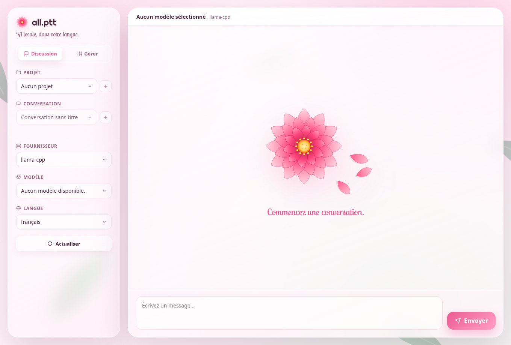

<p align="center">
  
</p>

# all.ptt

**Local AI, in your language.**

all.ptt is a local-first web frontend for running AI models on your own machine.
It connects to the backends you already use, discovers your local GGUF models,
and exposes their real settings through a translated, approachable interface.

The name is literal: **all** for the many backends it can drive, **ptt** because
it is just a name. Everything stays on your computer: no account, no telemetry,
no remote prompt storage.



## Why another frontend?

Most local AI frontends are powerful but assume you already know which flag to
pass to which backend. all.ptt is built around two ideas:

- **Translation is a first-class feature.** Every user-facing string lives in the
  i18n catalogs, and the i18n check refuses incomplete translations.
- **Settings are semantic.** You choose "GPU layers", "context size" or "flash
  attention"; all.ptt maps that to the right flag for the selected backend and
  hides what the installed binary does not support.

Customization stays open: backends, asset patterns, flags and translations are
data-driven and editable.

## Features

- **Local-first web UI**: runs on `127.0.0.1`, served by a small Node server.
- **Pluggable backends** through the OpenAI-compatible API: llama.cpp,
  ik_llama.cpp, Ollama, vLLM, or any other compatible server.
- **Prebuilt binary installer**: detects OS, architecture, CPU (AVX2/AVX512) and
  GPU (NVIDIA/AMD/Intel/Apple), downloads the matching release asset, and prunes
  old versions on update.
- **Progress controls**: install and update jobs show a top progress bar with
  pause, resume and cancel.
- **Backend lifecycle from the UI**: launch a model with an installed backend on
  a free port and stop it again.
- **Model discovery**: scans the Hugging Face cache and extra folders for GGUF
  files, with search, sorting, favourites and "open folder".
- **Metadata-aware classification**: detects mmproj, MTP, assistant, DFlash,
  DSpark, Eagle3, LiliCorr and DFlash2 files from GGUF metadata, not only names.
- **Per-model settings**: semantic settings with per-backend flag mappings,
  normal/advanced sections, OS-aware options, and a live RAM/VRAM estimate
  computed from GGUF metadata.
- **Speculative decoding**: draft models, automatic speculative type selection,
  file-less n-gram/suffix stages, and combinations such as MTP + n-gram.
- **Projects and conversations** stored as plain files, with a `notes.md` context
  file injected as a system message.
- **Five UI languages**: English, French, Spanish, German and Japanese, selected
  from the browser and remembered per user.
- **Self-update** for git checkouts, with an automatic restart.

## Quick start

Requirements: Node.js 20 or newer, npm, and optionally one AI backend.

```bash
npm install
npm start
```

The first run builds the web UI and the server bundle, then serves all.ptt at
<http://127.0.0.1:4750>. Keep the terminal open.

For development with hot reload:

```bash
npm run dev
# API on :4750, UI on :5173
```

## Backends

all.ptt never compiles a backend. It can download prebuilt binaries published by
the upstream projects, or connect to a server you already run.

- llama.cpp release binaries
- ik_llama.cpp prebuilt binaries from Thireus
- Ollama
- vLLM
- any server exposing `/v1/models` and `/v1/chat/completions`

### Configure a backend

Create `config.json` (see `config.example.json`):

```json
{
  "host": "127.0.0.1",
  "port": 4750,
  "providers": [
    { "id": "llama-cpp", "kind": "llama-cpp", "baseUrl": "http://127.0.0.1:8080/v1" },
    { "id": "ollama", "kind": "ollama", "baseUrl": "http://127.0.0.1:11434/v1" },
    { "id": "vllm", "kind": "openai-compatible", "baseUrl": "http://127.0.0.1:8000/v1" }
  ],
  "modelDirs": ["/path/to/more/models"]
}
```

Environment overrides: `PTT_HOST`, `PTT_PORT`, `PTT_CONFIG`,
`PTT_BACKEND_ROOT`, `PTT_MODEL_DIRS` (path-delimiter separated),
`PTT_TRANSLATION_PROVIDER`, `PTT_TRANSLATION_MODEL`.

### Optional: translate backend help dynamically

Backend settings that come from `--help` (no curated i18n key) can be
translated on demand through a model already served by one of your providers:

```json
{
  "translation": {
    "providerId": "llama-cpp",
    "model": "plamo-3-translate-0.8b-Q4_K_M"
  }
}
```

`PLaMo 3 Translate 0.8B` ships official GGUF files and runs natively on
llama.cpp (about 0.57 GB at Q4_K_M, 53 languages including Simplified and
Traditional Chinese). NLLB and T5 are encoder-decoder models and are **not**
usable through `llama-server`; they are intentionally not supported. When
translation is disabled or fails, descriptions fall back to English.

### Add a custom backend

From **Manage → Add backend** you can register:

- **A local binary**: point to an executable already on disk. It is treated as a
  pre-installed backend, launched with `-m {model} --host {host} --port {port}`
  unless you provide a custom model argument, base arguments or health path.
- **A GitHub release**: enter `owner/repository`, load its releases, pick the
  asset for your machine and the binary name. The backend is stored under
  `.ptt/backends.json` and future updates reuse the normal install/update flow.

Custom backends are stored outside the repository in `.ptt/backends.json`, so
they survive updates of PTT itself.

### Install binaries from the UI

Open **Manage**, choose a backend variant and click **Install** or **Update**.
The top bar shows the backend name, asset, bytes and percentage, with pause,
resume and cancel. On update, old tags and unused variants are removed so disk
usage stays roughly constant.

The same actions are available from the CLI:

```bash
npm run backend:info
npm run backend:list
npm run backend:install
npm run backend:update
npm run backend:install -- llama-cpp --variant cuda
npm run backend:install -- llama-cpp --dry-run
```

Default policy:

- CPU-only x86 (AVX2/AVX512) uses **ik_llama.cpp** by default.
- Everything else uses **llama.cpp**.
- CUDA is opt-in with `--variant cuda` on either backend.
- ik_llama.cpp is declared for x86 CPU and NVIDIA only.

Sources and asset matching are defined in `backends.json`. Patterns are matched
against GitHub release asset names, with placeholders `{cpu}`, `{cuda}`, `{os}`
and `{arch}`.

## Models and settings

all.ptt scans the Hugging Face cache (`~/.cache/huggingface/hub` by default) and
any folders listed in `modelDirs`. Files are classified from GGUF metadata
(`general.architecture`, `general.type`, `general.tags`) and matched to the
selected model by base architecture and context length. An E2B model therefore
offers E2B MTP files, not a 26B one. Diffusion and other non-text GGUF files are
ignored because they carry no tokenizer. Each card shows the full file name and
the quantization read from metadata or the file name.

Settings are discovered from the installed binary's `--help`, so renamed flags
or new versions are handled automatically. The panel exposes:

- context size, batch size, parallel slots and micro-batch size
- CPU threads, CPU range, CPU affinity, NUMA and process priority
- GPU layers, flash attention, tensor split, main GPU, split mode, KV offload
- KV cache types for K and V (`f32`, `f16`, `bf16`, `f8_e4m3`, `q8_0`, `q4_*`,
  `iq4_nl`, `q5_*`)
- repacking, MTP merge, sampling parameters
- draft model, draft GPU layers, draft context and draft cache types
- mmproj path, projector offload, image token limits
- speculative types such as n-gram, suffix and MTP, with file-less stages that
  can be combined with a draft or MTP stage

A live memory estimate (RAM/VRAM) is computed from the GGUF metadata, the
context size, the number of GPU layers and the KV cache types. It covers model
weights and the KV cache, not runtime compute buffers.

Settings are saved per model in `.ptt/model-configs.json` and applied when the
model is launched.

## Projects and conversations

Projects are plain folders, not a database:

```text
.ptt/projects/<id>/
  project.json                  name and timestamps
  notes.md                      project context, sent as a system message
  conversations/<id>.json       conversation title and timestamps
  conversations/<id>.jsonl      messages, append-only
```

`notes.md` is human-editable and read by all.ptt before each message.
Conversation titles are derived from the first user message. Everything stays
local and gitignored.

## Interface

- Flower identity and a pale-pink glass theme with depth.
- **Righteous** for the logo and headings, **Lobster Two** for accents.
- Decorative leaves scattered around the interface.
- Automatic browser-language detection with a manual language selector.
- The chat header always shows the selected model and backend.

## Docker

```bash
docker build -t all-ptt .
docker run --rm -p 4750:4750 -v "$PWD/config.json:/app/config.json" all-ptt
```

Backends running on the host are reachable at
`http://host.docker.internal:<port>/v1` (Linux may need `--add-host`).

## Single binary

```bash
npm run build:binary   # requires Bun; output: dist/ptt
```

## Configuration reference

| Key | Meaning |
| --- | --- |
| `host` / `port` | Address served by the web UI (default `127.0.0.1:4750`) |
| `providers` | Static OpenAI-compatible providers |
| `backendRoot` | Folder containing `.backends/` (default: current folder) |
| `modelDirs` | Extra folders searched for GGUF files |
| `translation` | Optional `{ providerId, model }` used to translate dynamic backend help |

Runtime data lives under `.backends/` (downloaded binaries) and `.ptt/`
(per-model settings and projects). Both are gitignored.

## Architecture

```text
packages/core        domain types, memory estimate, provider contract
packages/providers   OpenAI-compatible client and provider factories
packages/i18n        locale list, detection, Fluent translator
packages/backends    binary install/update, GGUF parsing, settings, launcher
apps/server          HTTP API, jobs, projects, routing, static assets
apps/web             Vite + TypeScript UI (icons, flower, views)
scripts              asset generation, i18n gate, bundling
```

The production server is a single bundled file and needs no `node_modules` at
runtime. The web UI is embedded in it, so a production install is one process.

## Development

```bash
npm run dev          # API + web with hot reload
npm run check        # typecheck + i18n parity + tests
npm test             # unit tests
npm run check:i18n   # translation gate
npm run build        # web + server bundle
```

### Add a backend

Add an entry to `backends.json`:

- source repository and asset selection rules
- binary names to discover inside the archive
- semantic setting mappings
- suggested speculative types per draft category

The UI and installer pick it up automatically. No code change is required.

### Add a language

1. Copy `packages/i18n/locales/en.ftl` to `<locale>.ftl` and translate.
2. Add the locale code to `SUPPORTED_LOCALES` in `packages/i18n/src/locales.ts`.
3. Run `npm run check:i18n`.

The UI selects the language from the browser; users can always switch manually.

## Current limits

- No MCP tool connections yet.
- No canvas or rich document editor.
- No reasoning/thinking blocks yet.
- No built-in model training or fine-tuning (all.ptt is a frontend, not a
  training library).
- Self-update is intended for git checkouts with a clean working tree.

## License

all.ptt is licensed under the **GNU General Public License v3.0 only**
(`GPL-3.0-only`). This is a strong copyleft license: if you distribute a modified
version, the source must stay open under the same terms. See [LICENSE](LICENSE).

Bundled fonts:

- Righteous — SIL Open Font License 1.1
- Lobster Two — SIL Open Font License 1.1

License files are in `apps/web/public/fonts/`.

## Contributing

Contributions are welcome: new backends, better asset patterns, translations,
UI polish, or bug reports. Keep the existing principles in mind:

- one file per responsibility;
- short comments, in English;
- no hardcoded backend names or flags when `backends.json` can describe them;
- every new user-facing string translated in every supported locale.
